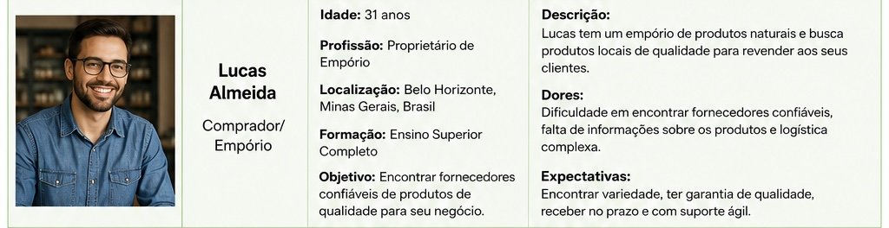
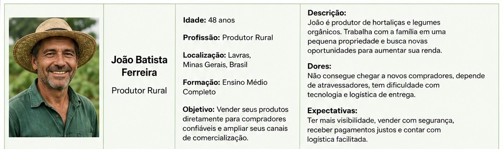

# Especificações do Projeto
## Personas
</img>
</img>
</img>
</img>
## Histórias de Usuários

| ID | Eu como | Preciso | Para |
|---|---|---|---|
| HU01 | Produtor | Conectar-me com potenciais clientes em minha região | Resolver a invisibilidade da oferta, hoje fragmentada e pouco divulgada |
| HU02 | Produtor | Informar registro de agricultor familiar (CAF) no perfil | Conferir credibilidade e transparência ao comprador |
| HU03 | Produtor | Cadastrar e editar meus produtos (nome, quantidade, preço) | Controlar minha vitrine de venda e divulgar a produção |
| HU04 | Produtor | Definir se o produto está disponível para entrega agendada, retirada, ou ambos | Garantir flexibilidade logística, levando em consideração capacidade de transporte e limitações de infraestrutura |
| HU05 | Produtor | Controlar disponibilidade de estoque após uma venda | Manter a vitrine do produtor atualizada, evitando que compradores encontrem ofertas desatualizadas |
| HU06 | Produtor | Consultar o histórico de pedidos recebidos | Organizar a produção com base na demanda já registrada, facilitando o controle de vendas |
| HU07 | Cliente | Visualizar produtos disponíveis de produtores na minha região | Adquirir produtos saudáveis e fortalecer o comércio local |
| HU08 | Cliente | Filtrar produtos por tipo (ex.: hortaliças, frutas, laticínios) | Agilizar a busca, tornando a experiência de compra mais eficiente |
| HU09 | Cliente | Agendar uma entrega de produtos | Adequar a compra à minha disponibilidade |
| HU10 | Cliente | Entrar em contato com o produtor | Alinhar detalhes específicos da compra (quantidade, ponto de encontro, prazo) diretamente com o produtor |
| HU11 | Cliente | Consultar o histórico de compras realizadas | Acompanhar produtores com quem já negociou, facilitando compras recorrentes e fidelização |
| HU12 | Cliente | Avaliar o produtor após a compra | Gerar confiança para futuros compradores e retorno de qualidade ao produtor |

## Requisitos

As tabelas que se seguem apresentam os requisitos funcionais e não funcionais que detalham o escopo do projeto.

### Requisitos Funcionais

| ID | Descrição | Prioridade |
|---|---|---|
| RF01 | A plataforma deve permitir que usuários se cadastrem e façam login, selecionando seu perfil (produtor, comprador ou administrador). | Alta |
| RF02 | A plataforma deve validar a documentação do produtor (CPF, nome da unidade familiar e número do CAF), com campo opcional para registro IMA em produtos processados. | Alta |
| RF03 | A plataforma deve associar automaticamente o produtor à sua microrregião de Minas Gerais a partir da localização cadastrada. | Alta |
| RF04 | A plataforma deve permitir que o produtor cadastre, edite e remova seus produtos (nome, categoria, preço, quantidade e fotos). | Alta |
| RF05 | A plataforma deve permitir que o comprador busque produtores e produtos por microrregião, com filtros por produto, categoria e preço. | Alta |
| RF06 | A plataforma deve permitir um que o comprador faça pedidos diretamente ao produtor e acompanhe a confirmação ou recusa do produtor | Alta |
| RF07 | A plataforma deve permitir que o produtor visualize e atualize o status dos seus pedidos (itens, dados do comprador e forma de entrega). | Alta |
| RF08 | A plataforma deve permitir que o comprador escolha entre entrega agendada (data/horário) ou retirada no produtor. | Média |
| RF09 | A plataforma deve permitir que o comprador avalie e comente sobre o produtor após a compra, exibindo a avaliação no perfil público dele. | Média |
| RF10 | A plataforma deve permitir que o administrador aprove ou recuse cadastros de produtores com base na documentação, notificando o resultado | Alta |
| RF11 | A plataforma deve permitir que o comprador salve produtores e produtos favoritos para acessá-los rapidamente e receber novidades. | Baixa |
| RF12 | A plataforma deve permitir que o administrador acesse relatórios de vendas, produtores e microrregiões, com filtro por período. | Média |
| RF13 | A plataforma deve permitir que produtor e comprador troquem mensagens entre si. | Média |

### Requisitos não Funcionais

| ID | Descrição | Prioridade |
|---|---|---|
| RNF01 | A plataforma deve permitir que um usuário conclua o cadastro e a primeira busca em até 5 minutos, sem ajuda. | Alta |
| RNF02 | A plataforma deve responder às ações principais (login, busca, cadastro) em até 3 segundos. | Alta |
| RNF03 | A plataforma deve impedir que um usuário comum acesse funções exclusivas de administrador. | Alta |
| RNF04 | A plataforma deve funcionar em 3 navegadores diferentes e em 2 tamanhos de tela (computador e celular). | Alta |
| RNF05 | A plataforma deve ter testes automáticos que cubram pelo menos 70% das funções principais. | Média |
| RNF06 | A plataforma deve ter contraste de texto que atinja nota 90 ou mais em avaliação automática. | Média |

## Restrições
O projeto está restrito pelos itens apresentados na tabela a seguir.

|ID| Restrição                                             |
|--|-------------------------------------------------------|
|01| O escopo geográfico do projeto está limitado ao estado de Minas Gerais e à sua divisão em microrregiões. |
|02| Somente agricultores enquadrados como agricultura familiar, comprovadamente cadastrados no CAF, podem se registrar como produtores. |
|03| O registro no IMA é exigido apenas de produtores que comercializam produtos processados. |
|04| O pagamento é combinado diretamente entre produtor e consumidor, fora da plataforma — não há processamento de pagamento integrado. |
|05| A plataforma depende de conectividade à internet, que pode ser limitada em algumas áreas rurais atendidas. |
|06| O projeto está sujeito ao cronograma e aos critérios de avaliação definidos para esta etapa acadêmica. |

## Diagrama de Casos de Uso

